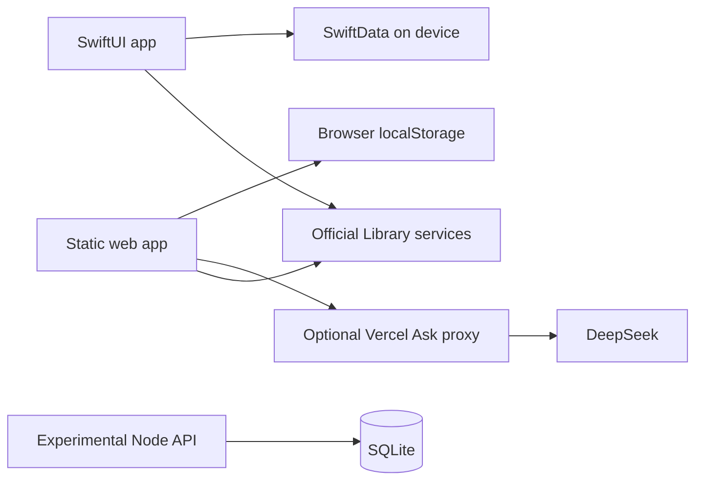

# Architecture and implementation boundaries

## Current paths

The API is intentionally shown separately: no client uses it yet. Native Ask tries the legacy configured provider, Apple's on-device model, then local catalog search. An extractable provider key must not ship in a distributed native app. The web proxy uses a server environment key and redacts selected personal-data patterns; pattern redaction cannot guarantee anonymity. Do not include sensitive information in questions.

## Experimental API contract

Node 24, built-in HTTP and SQLite, no third-party runtime dependencies. `server/src/schema.sql` defines the schema; `server/src/catalog.json` seeds public services. WAL data is created outside source control. Back up the database using SQLite's backup facility or stop the server before copying all database files.

| Route | Access | Behavior |
| --- | --- | --- |
| `GET /health` | Public | Liveness |
| `GET /api/services`, `GET /api/services/:id` | Public | Catalog |
| `POST /api/session/anon` | Public | Anonymous user and bearer token |
| `GET /api/me` | Bearer | Profile, XP, stamps, chests |
| `GET /api/feed` | Bearer | Ranked catalog cards with explanation |
| `GET /api/plan` | Bearer | Personal plan |
| `POST /api/plan` | Bearer | Save `{serviceId, source}` |
| `POST /api/plan/:id/complete` | Bearer | Complete service and settle eligible quests |
| `DELETE /api/plan/:id` | Bearer | Remove saved item |
| `POST /api/events` | Bearer | Record `{type, serviceId}` |

Tokens are random and stored hashed. SQL is parameterized. These protections do not replace missing rate limits, session expiry/revocation routes, account deletion, complete body validation and an operational privacy policy. Invalid JSON handling is inconsistent. The API is for local development, not a public production deployment.

Known reward limitations: the empty requirement list means First Steps never settles; deleting a completed plan item and completing it again can award service XP again. Quest rewards are guarded separately. These need regression-tested fixes in the server workstream. OAuth/UGC schema tables are scaffolding, not working login or moderation.

## Data and translation ownership

Public service data currently appears in Swift, web JavaScript, the Ask endpoint and the server JSON. Update relevant copies together and retain official sources in [Library services](../reference/library-services.md). A shared generated catalog is a future improvement. French catalog translation does not yet change the app UI.

[Decisions](decisions/0001-open-source-foundation.md) · [v1 storage record](v1-local-data.md) · [v2 proposal](../planning/v2-roadmap.md)
